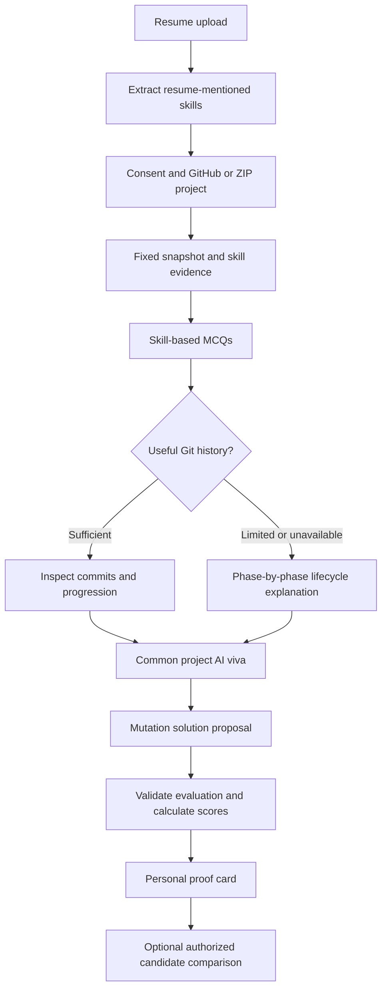

# ProofSkill — App Implementation Handoff

Version 1.3 | 30 October 2026

This document is ready to give to a coding assistant to build the app. It is an implementation specification, not a claim that the app already exists. It preserves the supplied candidate-only handoff and incorporates the owner's latest correction: no initial selected-skills step.

## Approved flow and scope

The assessment scope comes from skills mentioned in the resume. Do not ask the candidate to select skills at the beginning or insert a mandatory skill-confirmation gate. Authentication supports ownership; consent is still required before project analysis and external AI processing.



The history decision is made from inspected history, not from merely having a GitHub account. Both branches must complete the same scored viva and mutation framework. Project evidence is displayed as Supported, Partial, Not detected, or Inconclusive.

| Item | Required behavior |
| --- | --- |
| Skill source | Extract claims from the resume; no initial skill picker |
| Project evidence | Ground questions and explain project backing; no direct marks |
| MCQs | 20% of each skill score |
| Git history / lifecycle | Routing and development context; no direct marks |
| Common project viva | 35% of each skill score; required for every candidate |
| Mutation | 45% of each skill score; assess a proposed change without code execution initially |
| Proof card | Saved scores, explanations, evidence, confidence, gaps and improvements |
| Comparison | Optional, authorized, compatible common skills; no recruiter dashboard |

Question counts, timing, providers and other items marked Proposed below remain implementation defaults to validate. They must not be presented as approved product changes. The current document proposes a fixed MCQ blueprint per skill; it does not specify fewer MCQs for backed skills and more for unbacked skills. Do not add that adaptation silently.

## How to use this handoff

Give this entire file to the coding assistant. The ready-to-copy starting prompt is included below. Implement the candidate journey as working end-to-end milestones, with real persistence and explicit labels for fixtures or pending integrations. Read the entire specification before changing code. Do not add rounds or product features beyond this scope.

---

# Project Based Technical Skill Assessment System — Candidate Only

# Implementation handoff for a coding assistant

Version 1.3 — Candidate-only scope | 30 October 2026

Purpose: provide one portable source of truth for implementation in Claude, Gemini, Codex, or another coding environment. This is a planning and implementation document, not an application codebase. No app is being deployed by this handoff.

## Candidate-only scope update

This revision removes the employer-facing dashboard, job requirements, and job-based matching. It retains a candidate-facing, consent-based comparison of two proof cards. Assessment starts directly with candidate resume intake. Candidate assessment weights, history routing, evidence handling, and review protections remain as specified below.

Main journey: resume upload and skill extraction → consent and GitHub/ZIP project → fixed snapshot and project-backing review → MCQs → history check → lifecycle explanation when needed → common project AI viva → mutation challenge → validated scoring → personal proof card and improvement guidance → optional comparison with another authorized proof card.

The conditional lifecycle explanation is the phase-by-phase core explanation of how the candidate built the project. Every candidate still completes the common viva and mutation. Mutation initially assesses a proposed fix or change; candidate code is not executed. The document is an implementation specification, not evidence of working app code.

## Instructions for the coding assistant

This is a standalone handoff for building the application. Read it completely before editing. The owner is learning development and needs concise, simple explanations, runnable code, clear file locations, and a polished hackathon demonstration. Do the implementation, not just a plan. No existing application has been inspected or verified in this handoff.

### Source of truth and decision handling

- The assessment flow and weights stated here are agreed. Do not change them or introduce extra scored rounds.
- The visual direction below is the implementation direction for the frontend. A polished landing page alone is not the deliverable.
- Items explicitly marked Proposed are concrete starting defaults, not claims that the owner has approved every detail. Use reversible implementation defaults where needed, centralize them in configuration, and record them in docs/DECISIONS.md. Ask only when a missing decision blocks implementation or changes assessment meaning, privacy, cost, or production access.
- Preserve the distinction between assessed knowledge, implementation evidence, development context, project understanding, adaptation, and confidence.
- Separate confirmed behavior, implemented behavior, mocked behavior, and pending integration. Do not claim a feature works merely because its screen exists.
- No design guarantees winning a hackathon. Prioritize an inspectable, coherent working demonstration of the core idea.

### Scope and priority

Build a candidate-only assessment application. The only public product dashboard is the candidate dashboard, including an optional two-card comparison page. The journey starts directly with resume upload and skill extraction. Keep tutorial indicators and the IMATS adapter as separately tracked modules pending supplied reference data and the real sandbox contract; they must not change the assessment rounds. This reduced scope does not claim complete coverage of the original official problem statement.

Do not add a second MCQ round, voice interviews, mandatory public GitHub, runtime execution, payment features, social features, or a broad web plagiarism search. A source-code similarity observation must never become an unsupported authorship verdict.

### Working method

1. Inspect the current repository and its instructions first. Reuse working code; do not overwrite an existing application with a new scaffold without need.
2. If starting empty, create one TypeScript repository with npm workspaces. Use React with Vite for web, Express for API, Prisma with PostgreSQL, and a separate Node worker. Select compatible supported versions from current official documentation and commit a lockfile. This document does not certify package versions.
3. Use Zod at API and AI boundaries. Keep shared browser-safe contracts separate from server-only scoring and analysis packages.
4. Create docs/IMPLEMENTATION_STATUS.md listing each feature as not started, fixture only, working locally, tested in staging, or released. Record real blockers and next steps.
5. Implement in milestones. At the end of each, state what changed, where the files are, how to run it, what was verified, and what remains. Continue through authorized work without repeatedly asking whether to proceed.
6. If credentials or an external contract are missing, build the real adapter boundary and an explicitly labelled fixture adapter. Keep the missing live integration in the status file. Do not fabricate remote endpoints or successful provider calls.
7. Keep the README accurate. Only document commands after adding working scripts. Provide .env.example with placeholders, never secrets.
8. Run checks appropriate to the milestone, including server ownership checks and scorer tests. Keep the application runnable between milestones.

## Frontend implementation direction

### Visual system

Use a light assessment workspace, dark navy navigation and headings, teal primary actions, amber pending or incomplete states, and red only for failures or destructive actions. Color is always accompanied by a label or icon. Use one readable sans-serif typeface and a consistent spacing scale. Keep code panels dark with readable syntax highlighting. Prefer restrained transitions and respect reduced-motion settings.

The main product is a working assessment platform. Avoid decorative chart overload, invented success statistics, fabricated customer logos, and large marketing sections that hide the assessment. Desktop is the primary judge demonstration surface; all screens must remain usable on smaller widths.

### Pages and behavior

| Page | Required visible behavior |
| --- | --- |
| Entry | Brief purpose, candidate sign-in, clearly labelled sample proof card |
| Candidate home | Current assessment, resume-derived assessment skills, submitted project, stage, one next action |
| Resume and skills | Accessible upload, extraction state, resume-derived skills and extraction status; no skill-selection gate |
| Project submission | Consent, GitHub or ZIP choice, limits, access errors, chosen snapshot |
| Evidence review | Safe source references, narrow findings, limitations, issue flagging |
| MCQs | Progress, options, autosave, server-backed deadline when enabled, explicit final submission |
| Lifecycle | Only shown when routed, structured text prompts, autosave |
| Viva | Relevant source on the left, grounded question and answer on the right |
| Mutation | Current behavior, requested change, solution editor, reasoning and verification plan |
| Proof card | Overall eligibility, per-skill results, component breakdown, evidence and uncertainty |
| Candidate comparison | Two authorized proof cards, common assessed skills, component differences, reasons and comparability limitations |

On narrow screens, stack source context above the question and preserve the active response. Navigation must support keyboard use, clear focus, labelled controls, and screen-reader announcements for saved status and failures. Do not lose answers on refresh or during a failed request. Show loading, empty, retryable failure, incomplete, and success states throughout.

### Important interaction decisions

The candidate dashboard prominently shows Continue assessment rather than many competing buttons. The next action comes from the backend's allowedActions, not a guessed browser-only stage.

Viva and mutation tasks show the exact stored source excerpt and snapshot reference used to generate the task. The original source is read-only. Candidate patch proposals are separate text, never edits to the original uploaded snapshot or pushes to their repository. Do not show a Run code button when execution is unavailable.

The proof card's Why this result control opens a readable chain from score to rubric findings and relevant answer or evidence references. Show scored performance separately from supporting implementation and history information. Do not visualize confidence as a made-up probability.

Evidence issue reporting is an optional pre-round usability enhancement: let candidates flag a wrong code reference or interpretation, save the flag for review, and resolve invalid context before serving affected tasks. Candidates cannot freely overwrite findings. If this enhancement is deferred, maintain the ordinary review request path.

## Detailed code placement

Use the following as a concrete starting structure. Small modules can start with fewer files; do not create empty layers merely to fill the tree.

```text
proof-of-skill/
  apps/
    web/
      src/
        app/                  # Router, layout, providers, protected routes
        features/
          auth/
          assessment/         # Resume, skills, consent, project, progress
          mcq/
          lifecycle/
          viva/
          mutation/
          proof-card/
          comparison/
        components/           # Shared interface components
        services/             # Typed backend client and feature requests
        styles/               # Tokens and global styling
    api/
      src/
        app.ts                # Express setup, middleware, route registration
        server.ts             # Start the HTTP server
        config/               # Validate runtime environment
        middleware/           # Authentication, access, errors, rate limits
        modules/
          assessments/
          resumes/
          skills/
          consents/
          projects/
          evidence/
          history/
          rounds/
          scorecards/
          comparisons/
          reviews/
        integrations/
          auth/
          github/
          ai/
          storage/
          imats/
        jobs/                 # Enqueue and inspect durable task records
        db/                   # Prisma client setup
    worker/
      src/
        index.ts              # Worker startup and task claiming
        handlers/
          extractResume.ts
          prepareProject.ts
          analyzeProject.ts
          inspectHistory.ts
          generateRound.ts
          evaluateAnswers.ts
          finalizeScorecard.ts
  packages/
    contracts/                # Browser-safe schemas, DTOs, status names
    analysis/                 # Server-only file scanning and evidence rules
    scoring/                  # Server-only pure grading and aggregation
    server-core/              # Optional shared server services and adapters
  prisma/
    schema.prisma
    migrations/
    seed.ts                   # Reviewed questions and labelled demo data
  tests/
    integration/
    e2e/
    fixtures/                 # Small authorized non-secret sample projects
  docs/
    IMPLEMENTATION_HANDOFF.md
    DECISIONS.md
    IMPLEMENTATION_STATUS.md
    DEPLOYMENT.md
  .env.example
  .gitignore
  package.json
  README.md
```

Each API module should use a route file for request handling, a service file for business operations, and schemas for runtime validation. Database reads can remain in the service initially; introduce a repository layer only if it clarifies real complexity. Workers and API may share server services through an internal server package; never duplicate scoring rules in both or import server modules into the web bundle.

Code analysis rules belong in packages/analysis, for example reactState.rule.ts. Pure scoring belongs in packages/scoring, for example calculateSkillScore.ts. Keep answer keys in protected database fields loaded by server grading logic, not in shared contracts, frontend fixtures, or client bundles.

Persistent uploads belong in protected object storage. Only generated temporary work directories belong on processing service disks. All user-provided filenames are data; do not use them as trusted storage paths.

## Minimum data and evaluation contracts

The numbered specification below lists entities and APIs. These additional conventions help different coding assistants implement the same behavior.

### Ownership and identity

Use one authenticated user reference per request. Assessment IDs are resource identifiers, not permission grants. Resolve candidate ownership or explicitly authorized operational access before reading, writing, downloading, polling a task, or generating a signed file URL. Return safe not-found or forbidden responses without revealing unrelated candidate records.

### Evidence contract

An evidence record contains id, assessmentId, snapshotId, skillId, topicId, ruleId, ruleVersion, classification, findings, sourceReferences, limitations, and createdAt. A source reference contains the relative file path, file hash, start and end location, and a protected excerpt reference where appropriate. All references must resolve against the selected snapshot.

### AI evaluation contract

An evaluation contains taskId, skillId, rubricVersion, criterionRatings, reasons, evidenceReferences, and reviewFlags. Criterion ratings must be within the published rubric scale. The server records model and prompt versions separately. A schema-valid response is not automatically approved: reject nonexistent references, wrong skill assignments, missing criteria, and unsupported claims. Persistent failures become NEEDS_REVIEW.

### Scoring contract

The scorer accepts saved validated component percentages, completeness and coverage results, and a policy version. It returns a complete skill score only when all required components are valid and complete. Do not treat pending values as zero or renormalize the final 20/35/45 weights around missing components.

```text
calculateSkillScore({ mcq: 80, viva: 70, mutation: 90 }) = 81.0
overall([81, 75, 72]) = 76.0 only if all resume-derived assessment skills are complete
```

Tasks that cover multiple skills need preassigned rubric criteria for each skill. Do not copy the same entire answer score into every resume-derived assessment skill. Follow ups do not create extra topic weight or unbounded attempts.

### Incomplete and error states

Keep workflow stage, processing status, evaluation review status, and score completeness separate. A failed AI request does not mean a candidate failed a technical question. Finalize answers once, autosave drafts with revision checks, and retry technical operations idempotently. Publish no overall complete score while a resume-derived assessment skill lacks required context or component coverage.

## Hackathon demonstration plan

Use one authorized shopping-cart sample with a real React state implementation. Walk through extracted resume skills, snapshot and evidence, a project-grounded viva, a discount mutation, the proof card explanation. Prepare a second small ZIP example to demonstrate the lifecycle route without a scoring penalty.

Use stored fixture responses for an offline fallback only when clearly marked Demo data. A live demo and an offline fallback must have distinct status labels. Do not fabricate commit history, completed tests, model responses, candidate scores, IMATS connectivity, or evaluation metrics.

The mutation result must say assessed proposal unless code was genuinely executed in a separately designed runner. Label sample proof cards as examples. Explain why the score exists by showing answer and rubric evidence, not an unexplained AI percentage.

## Ready to copy starting prompt

```text
Read the attached implementation handoff completely. Act as the implementation
engineer for this hackathon application. The handoff is the product baseline.

First inspect my existing repository, its instructions, and working files.
If it is empty, scaffold the TypeScript workspace described in the handoff.
Preserve existing usable code and do not overwrite unrelated work.

Build the candidate assessment flow first. Use React/Vite, Express/Node,
PostgreSQL/Prisma, private file storage, and a separate worker. Verify current
official package documentation before selecting compatible versions.

Preserve the exact order: resume and skill extraction without a selection gate, consent and project, snapshot
and evidence, MCQs, history routing, lifecycle when needed, common viva,
mutation, validated scoring, and proof card. Each skill is scored 20 percent
MCQs, 35 percent viva, and 45 percent mutation. Evidence and history do not
directly add marks. Missing components remain incomplete.

Implement the polished light/navy/teal interface and source-plus-question
assessment workspace. Mutation initially collects a proposed change and
reasoning without executing candidate code. Keep source snapshots read-only.

Build runnable vertical slices, not a dashboard full of nonfunctional buttons.
Use real backend persistence and server-side authorization. Keep credentials
and answer keys out of the frontend. Label fixture integrations clearly.

Build only the candidate experience and restricted operational support.
Tutorial indicators and IMATS remain pending modules: inspect real inputs and
contracts before implementing, and never invent capabilities or endpoints.

Create DECISIONS.md, IMPLEMENTATION_STATUS.md, .env.example, and a working
README. Make reversible routine choices, record them, and avoid unnecessary
questions. Ask only for material blockers such as credentials or changes to
assessment scope. Do not claim unimplemented or untested features work.

Begin by inspecting the repository, briefly reporting what exists, and then
implementing the foundation and first working candidate journey. Continue
through authorized milestones while reporting concrete progress and checks.
```

The complete product specification follows. Read it together with these instructions; the introductory additions clarify code placement and frontend delivery without adding assessment rounds.

---

## Complete product specification

### Candidate-only baseline version 1.3

Version 1.3 | 30 October 2026 | Candidate assessment scope adapted from IM 105

This specification defines the product we intend to build, its assessment logic, user journeys, data model, interfaces, reliability requirements, and release process. It is a baseline for review before development. The agreed scoring policy is MCQs 20 percent, project viva 35 percent, and mutation challenge 45 percent for each assessed skill. Project implementation evidence and development history carry no direct marks.

The application has not been implemented or deployed as part of this specification. Technology selections and numerical operating limits labelled Proposed are implementation defaults for review. Required external integration details must be verified before release.

## 1 Product purpose and problem alignment

### 1.1 The candidate assessment problem

A resume lists claimed technologies but does not show how well a candidate understands or can adapt their own implementation. The candidate submits a resume and project, has resume-mentioned skills extracted, and completes knowledge questions, project explanations, and controlled change challenges.

The output is a personal proof card separating assessed knowledge, project understanding, adaptation, implementation evidence, development context, and remaining uncertainty.

### 1.2 Outcomes in this scope

Produce evidence backed skill profiles, analyze repository evolution where accessible, offer a lifecycle explanation path when history is unavailable, conduct a project based AI viva and mutation challenge, attach evidence and confidence to skill claims, and provide candidate improvement guidance. Accept GitHub URLs and project ZIPs. Retain tutorial indicators and IMATS as separately tracked integrations pending real inputs.

Candidate consent is required before analysis. College name, gender, age, and location must not affect proficiency scores. Validate source findings, rubric evaluations, and candidate understanding of the proof card.

### 1.3 Supplied evaluation resources

The source problem statement describes 400 anonymised fresher profiles with consented repositories and assessment results, labelled tutorial project examples, and an IMATS sandbox API. These resources have not been inspected here. Check availability, fields, consent boundaries, and labels before dataset dependent work. Use only resources relevant to candidate assessment.

### 1.4 Claims and limitations

This document specifies a candidate-only product, not an implemented application. Static analysis and an interview cannot establish authorship. A common project type, short Git history, or similar interface does not establish copying. AI feedback is fallible and must retain its supporting references. No assessment accuracy or time saving is claimed as measured until evaluated. This reduced product scope is not a claim of full official problem-statement compliance.

## 2 Decision status and scope

### 2.1 Agreed product decisions

- One candidate dashboard contains intake, assessment rounds, progress, evidence, and proof cards. Restricted operational tools support question publishing and error review.
- The system derives assessment skills from the resume; candidates submit GitHub URLs or project ZIPs without a separate skill-selection or confirmation step.
- The round order is evidence collection, MCQs, history routing, conditional lifecycle explanation, common viva, mutation challenge, consolidation, and scoring.
- Every candidate takes the viva and mutation challenge. Useful history bypasses only the lifecycle explanation.
- Each skill is scored with MCQs 20 percent, viva 35 percent, and mutation 45 percent. Evidence and history have no direct marks.
- Missing or unavailable evidence does not silently become zero. Confidence is separate from proficiency.
- Backend rules calculate scores. AI provides structured rubric evaluations and explanations.

### 2.2 Proposed implementation baseline

Begin with JavaScript and TypeScript projects, a reviewed MCQ bank, text based viva, and a mutation response containing a proposed patch or pseudocode plus explanation and verification plan. Do not execute candidate code in the first release. Label mutation results as assessed proposals rather than verified runtime fixes.

Use one project snapshot per assessment attempt. A later project or reattempt creates a separate assessment; results are not automatically merged. Use a modular backend with a separate worker process and durable processing records. Use managed authentication, PostgreSQL, and protected object storage; providers remain subject to selection.

### 2.3 Release boundaries

The end to end product covers candidate assessment and the proof card. Tutorial indicators, IMATS integration, and assessment evaluation remain separately tracked requirements from the earlier handoff. Their completion is required before claiming those features work. Full official problem-statement compliance is outside this reduced scope.

Future extensions include additional programming languages, voice interviews, OCR for scanned resumes, automated execution in a hardened sandbox, and a standalone admin dashboard. They are outside the initial baseline. Basic question and rubric management can use restricted operational tools without creating a third public dashboard.

## 3 Roles permissions and dashboard pages

### 3.1 Candidate dashboard

Candidates can create and resume their own assessments, upload resumes, view extracted skills, record consent, submit projects, view processing progress, answer rounds, view proof cards, and request a review of an apparent error. They can see what data will be analyzed, why it is needed, and which external processors are used.

| Page | Purpose |
| --- | --- |
| Assessment home | Show attempts, current stage, pending actions, and failures |
| Resume and skills | Upload document and display extracted resume skills without requiring selection |
| Project submission | Record consent and accept GitHub URL or ZIP |
| Analysis progress | Show processing state and recoverable errors |
| MCQ assessment | Present questions and save answers |
| Lifecycle explanation | Appear only when useful history is insufficient |
| Project viva | Present code grounded questions and collect answers |
| Mutation challenge | Present a change and collect solution reasoning |
| Proof card | Show results, evidence, uncertainty, and next actions |
| Compare candidates | Compare own proof card with an explicitly shared second proof card |

### 3.2 Operational permissions

A restricted operator can publish reviewed questions, manage rubric versions, inspect failed processing, and resolve review requests. Operators cannot silently edit a published score. Corrections create an auditable evaluation revision and recalculated card. Candidate ownership and explicit operational permissions must be checked server side on every relevant request.

## 4 Candidate journey and workflow states

### 4.1 Normal assessment journey

1. Authenticate and create an assessment ID.
2. Upload a selectable text PDF or DOCX resume.
3. Extract resume-mentioned skills and establish the resume-derived assessment scope; do not insert a skill-selection or confirmation step.
4. Record analysis consent and accept a GitHub URL or ZIP.
5. Prepare an immutable project snapshot and collect code evidence.
6. Run skill based MCQs for extracted resume skills.
7. Evaluate useful development history for the selected snapshot.
8. If history is limited or unavailable, collect a lifecycle explanation.
9. Conduct the common project viva for every candidate.
10. Conduct the mutation challenge for every candidate.
11. Validate evaluations, consolidate findings, and calculate skill scores.
12. Publish the proof card in the candidate dashboard, with score explanations and improvement actions.

### 4.2 Routing rules

| Condition | Route | Scoring effect |
| --- | --- | --- |
| Sufficient useful history | History findings then common viva | No history bonus |
| Limited useful history | Lifecycle explanation then common viva | No penalty |
| Unavailable history including ordinary ZIP | Lifecycle explanation then common viva | No penalty |
| Processing or provider failure | Recover or request an alternative submission | No automatic zero |

A GitHub URL does not guarantee sufficient history. An archive normally contains source rather than accessible Git history. Proposed default: do not trust or process an uploaded .git directory; use the lifecycle path for ZIPs. A future separately authorized history import can be designed later.

### 4.3 State machine

Persist an assessment stage separately from background processing status. Proposed stages are DRAFT, SKILLS_EXTRACTED, PROJECT_SUBMITTED, EVIDENCE_READY, MCQ_COMPLETED, HISTORY_CHECKED, LIFECYCLE_COMPLETED when required, VIVA_COMPLETED, MUTATION_COMPLETED, EVALUATING, and COMPLETED or PROVISIONAL.

Processing jobs have QUEUED, RUNNING, SUCCEEDED, FAILED, and CANCELLED states. Evaluation records can be PENDING, VALIDATED, or NEEDS_REVIEW. A failed worker must not force an assessment back to an earlier stage or discard saved responses.

The server checks prerequisites before advancing. The resume-derived assessment scope and snapshot are frozen when scored rounds begin. Changing either after that point requires a new attempt or an explicit invalidation and restart policy. Technical retries reuse the same round and do not create additional opportunities to change submitted answers.

## 5 Proposed architecture and technology stack

### 5.1 System responsibilities

The React frontend presents candidate pages and calls the backend with the browser Fetch API. Express defines HTTP endpoints; Node.js executes business logic. Backend services handle identity checks, submissions, evidence, rounds, scoring, and review. A worker handles longer downloads, parsing, history retrieval, and AI requests.

PostgreSQL stores identities, metadata, responses, evaluations, scores, consent records, and review requests. Prisma provides typed database access and schema migrations. Protected object storage holds resumes, archives, snapshots, and any permitted excerpts. A durable job table tracks asynchronous tasks and recovery.

External connections are GitHub, an AI provider, a managed authentication service, and IMATS. All provider credentials stay on the server. The frontend never calls the AI provider or IMATS using secret credentials.

| Technology | Responsibility | Status |
| --- | --- | --- |
| React and TypeScript | Interfaces and development time checks | Proposed stack |
| Node.js and Express | APIs and backend services | Proposed stack |
| PostgreSQL and Prisma | Structured storage and migrations | Proposed stack |
| Multer | Receive multipart uploads | Proposed stack |
| PDF text reader and Mammoth | Extract PDF and DOCX text | PDF library to select |
| Streaming ZIP library | Inspect and extract archives safely | Library to select |
| GitHub REST API | Metadata, snapshots, commits, diffs | Required for GitHub path |
| Babel Parser and Traverse | Parse and inspect JS or JSX syntax | Proposed stack |
| TypeScript compiler API | Deeper TS analysis when needed | Optional initially |
| AI API and Zod | Evaluation assistance and structure checks | Provider to select |
| Protected object storage | Durable private file storage | Provider to select |
| Managed authentication | Accounts and sessions | Provider to select |

### 5.2 Code organisation

Proposed folders are apps/web for React, apps/api for Express, apps/worker for background entry points, packages/contracts for shared request types and validation, packages/scoring for deterministic calculations, packages/analysis for evidence rules, and prisma for schema and migrations. Tests and deployment configuration belong alongside their owning modules.

Keep business rules in backend services rather than route handlers. Frontend validation improves usability; backend validation remains authoritative. Shared types are not a substitute for checking runtime input.

## 6 Authentication assessment identity and consent

An assessment ID represents one candidate attempt; a project ID represents its submitted project. The backend derives candidate identity from the authenticated session, not a trusted userId supplied by the browser. Every record read must be scoped to candidate ownership or explicitly authorized operational access.

Proposed authentication uses a maintained managed provider with verified candidate accounts and restricted operational permissions. A sign in with GitHub is not mandatory. App authentication and permission to read a private repository are separate concerns. Operational privileges must not be self assigned from an editable profile field.

Consent records include candidate, assessment, permitted repository or ZIP scope, purpose, notice version, timestamp, and revocation status. Explain external AI processing and retention before submission. Revocation stops future analysis; retention and deletion treatment of already generated records must be defined before launch.

## 7 Resume extraction and resume-derived assessment scope

Accept selectable text PDFs and DOCX files initially. Multer receives the upload; the backend verifies allowed formats, signatures where applicable, size, and ownership. A PDF reader or Mammoth extracts text. The result is text, not a reliable skill profile.

A controlled technology dictionary maps aliases such as ReactJS and React.js to React, and Postgres to PostgreSQL. Use token boundaries and context checks rather than unrestricted substring matching. A statement about planning to learn React should not silently become a proficiency claim.

Display extracted resume skills and save the resume-derived assessment scope. Do not require candidates to choose skills or confirm a skill list before continuing. Apply the dictionary and context rules above; extraction errors use the review path rather than a mandatory selection screen. Proposed initial catalogue: JavaScript, React, Node.js with Express, and SQL knowledge. SQL project evidence support is limited to inspected query or database usage patterns; full SQL dialect analysis is not implied.

Scanned documents, legacy .doc files, corrupt PDFs, and empty extracted text produce clear messages. Request a supported readable resume; do not invent skills or add a manual skill-selection gate. OCR is a future extension. Store the source reference, extraction status, detected aliases, extracted resume skills, and dictionary version.

## 8 Project submission and reproducible snapshots

### 8.1 GitHub submission

Validate HTTPS GitHub URLs and extract owner and repository identifiers. Use the GitHub API to check access, resolve the selected branch to a commit ID, and download the source archive for that commit. Follow only permitted provider download redirects; never forward credentials to arbitrary hosts. Save the branch, commit ID, retrieval time, snapshot reference, and content manifest.

Record a hash for each extracted source file or a canonical manifest, plus an archive hash for transfer integrity. Commit references stabilize the selected contents even when a branch moves. Submodules and Git LFS material need explicit handling; if not retrieved, mark analysis coverage as limited rather than assuming they were inspected.

Proposed initial prototype supports public repositories and ZIP alternatives. Private repository support requires a separately implemented least privilege permission flow; do not claim it is available until tested.

### 8.2 ZIP submission

Validate the archive before extraction. Generate internal storage names. Reject absolute paths, parent directory escapes, symlinks, encrypted entries, and unsafe entry types. Enforce limits while streaming decompression, not only from archive metadata. Do not install dependencies or execute project scripts.

Proposed configurable limits are a 5 MB resume, 25 MB compressed project, 100 MB extracted project, 5000 entries, 1 MB per analyzed source file, and one archive level with no recursive nested extraction. These are protective starting values and require realistic project testing before lock. The interface must display actual enforced limits.

Extract into an assessment scoped temporary workspace, store the immutable source snapshot privately, and delete temporary files after processing. ZIPs and GitHub downloads receive equivalent extraction controls. Unsupported or oversized projects can be corrected and resubmitted before scored rounds begin.

## 9 Evidence collection and confidence

### 9.1 Analysis sequence

Read manifests such as package.json to identify possible technologies. Exclude node_modules, build output, minified bundles, binaries, secrets, and vendored sources from candidate implementation analysis. Parse relevant source files into abstract syntax trees using Babel, then apply custom versioned rules. Static analysis inspects code without running it.

For React state handling, a rule can connect a state declaration, its setter, an event handler, and a rendered state reference. Other initial rules can cover API requests with error handling, Express route registration, middleware usage, and observable database calls. Rules must account for aliases and scope within supported patterns; unresolved cross file behavior is a limitation.

### 9.2 Evidence classifications

| Classification | Meaning |
| --- | --- |
| Supported | Relevant connected implementation found within the rule scope |
| Partial | Some relevant implementation found but support is incomplete |
| Not detected | No matching implementation found in inspected content |
| Inconclusive | Coverage or analyzer capability prevents a determination |

Not detected does not mean the candidate lacks the skill. Dependency presence does not mean implementation. A parser does not assess proficiency, correctness at runtime, or authorship.

Each evidence record stores assessment, snapshot, skill, topic, rule ID and version, classification, file paths, line or column ranges, file hashes, narrow findings, limitations, and permitted excerpts. The backend validates every referenced file and range against the stored snapshot before use.

### Candidate-facing project backing summary

Display each extracted resume skill with its project backing status and the exact underlying evidence. Supported means project-backed within the inspected rule scope. Partial means partially backed. Not detected means no support was detected in inspected files; it is not proof the candidate lacks the skill. Inconclusive means the analyzer cannot decide. Keep these four labels visible instead of forcing uncertain findings into a binary verdict.

For example, a React dependency alone is not backing. Connected state, event handling, and rendering in an inspected component can support a narrow React state-handling claim. A SQL claim with no usable SQL source context can receive a knowledge result, but not a complete project-based skill score until suitable context is supplied.

### 9.3 Confidence policy

Confidence describes the support and coverage behind a finding, separately from score. Proposed labels are Limited, Moderate, and Strong support. Use reasons such as incomplete topic coverage, unresolved references, agreement across multiple answers, or validated contradictions. Publish the rubric used to assign labels. Do not generate percentages of certainty from an AI response.

Raw project complexity, file count, commit count, or number of technologies must not add marks. Evidence anchors viva and mutation tasks and appears on the proof card.

## 10 Skill based MCQ design

Resume-derived assessment skills determine sections. A reviewed question bank and a predefined topic blueprint determine coverage; source evidence may guide relevance within that blueprint. Claims without detected implementation still receive knowledge questions. Technologies detected only in project files do not automatically become resume skill claims or additional assessment sections. Resume-mentioned skills outside the supported catalogue remain visible as unsupported scope; do not assign fabricated scores or silently omit them from completeness reporting.

Proposed baseline is 10 questions per skill, with 3 basic, 5 intermediate, and 2 advanced questions. The question count and difficulty mix need a pilot for coverage and duration. Do not add a three-skill picker or silently truncate the resume skill list. Any workload limit affecting assessment coverage requires an explicit policy decision; it must not change this resume-first flow.

| Skill | Example blueprint topics |
| --- | --- |
| JavaScript | Scope, functions, arrays, promises, asynchronous behavior |
| React | Components, props, state, hooks, rendering |
| Node.js and Express | Routes, middleware, request handling, errors, asynchronous I O |
| SQL | Filtering, joins, grouping, keys, transactions |

Questions can assess concepts, code output, or short scenarios. Questions about a submitted function belong in the viva. Reviewed answer keys stay on the backend. Store the exact selected question versions and option ordering for each attempt. Candidate payloads contain question IDs, text, and option IDs but no answer keys or grading hints.

Proposed marking gives equal marks and no negative marking. MCQ percentage equals correct answers divided by the total assigned valid questions, multiplied by 100. Under a locked timed policy, unanswered questions after final submission count as incorrect; abandoned or technically interrupted rounds remain incomplete. Invalid questions require an auditable correction applied consistently to affected attempts.

Proposed timing is 15 minutes per 10 question skill section with server authoritative deadlines and autosave. Final duration, accessibility accommodations, allowed reference policy, and whether sections can be paused must be locked before publishing assessments.

## 11 Development history and lifecycle route

Inspect commits and changes reachable from the selected commit using GitHub APIs, with Git CLI optional for deeper future analysis. Assess meaningful implementation progression, dates, active development days, diffs, and limitations. A high commit count or long date range is not sufficient on its own.

Classify history as sufficient useful, limited, or unavailable. Save references and the routing reason. Proposed qualitative rule: sufficient history must show multiple inspectable changes that explain a meaningful feature progression; counts are supporting observations only. Exact thresholds require a versioned rubric and representative repository review before automatic routing is locked.

When history is limited or unavailable, collect text explanations of problem definition, requirements, architecture, technology choices, development stages, challenges, debugging, testing, and intended improvements. AI can identify consistency, detail, gaps, and relevant follow ups against source context. Lifecycle feedback receives no direct score and must not become a hidden extra scoring opportunity.

Both paths then enter the same viva and mutation framework. Evaluate comparable challenge difficulty across history paths. History availability must not change scoring weights, award bonuses, or directly lower confidence in unrelated demonstrated knowledge.

## 12 Project viva design

Every candidate completes a text based viva grounded in their snapshot. The backend selects topic relevant evidence and contextual code, then asks AI for questions with valid file references and target skills. Validate question relevance, supported references, difficulty, and rubric before presenting it.

Proposed minimum is three scored questions per skill covering at least two blueprint topics. Use a bounded follow up when an answer is unclear; preserve the same scoring opportunity and maximum marks across candidates. Follow ups clarify the same criterion rather than creating unlimited chances for one candidate.

| Viva criterion | Within viva weight |
| --- | --- |
| Technical correctness | 40 percent |
| Explanation of behavior and data flow | 30 percent |
| Reasoning behind decisions | 20 percent |
| Recognition of limitations and failure cases | 10 percent |

For example, ask how the cart quantity handler updates displayed totals and what happens with an empty cart. Evaluate correctness and relevant reasoning, not English fluency, length, confidence of delivery, or jargon. Candidate accessibility needs should be accommodated without changing the technical construct assessed.

Proposed anchors score each applicable criterion from 0 to 4: 0 incorrect or absent after valid submission, 1 major gaps, 2 partly correct with material gaps, 3 correct with minor gaps, and 4 correct, specific, and complete for the question scope. A platform failure is not a zero. Every published question must define applicable criteria and topic level examples before use.

## 13 Mutation challenge design

Mutation means a controlled change, introduced bug, or new requirement related to the submitted project. It checks whether the candidate can adapt their understanding. It is not random destructive editing of their original repository, and it does not mean the platform has implemented formal mutation testing.

Proposed initial format collects a suggested code change or pseudocode, reasoning, expected behavior, edge cases, and a verification plan. An editor can capture the answer as text. The backend retains the original snapshot and any submitted patch separately. No commit is pushed to the candidate repository.

Proposed minimum is two bounded challenges per assessed skill, covering different relevant topics. Challenges must have comparable scope, difficulty, available context, and time budget. Example: extend cart totals to apply an item specific discount while keeping quantity updates correct.

| Mutation criterion | Within mutation weight |
| --- | --- |
| Correctness of proposed solution | 40 percent |
| Reasoning about necessary changes | 30 percent |
| Edge cases and effects on existing behavior | 20 percent |
| Verification approach | 10 percent |

Use the same 0 to 4 anchor scale with challenge specific expected outcomes and acceptable alternatives. A verification plan earns verification reasoning marks, not credit for tests that were never run. Display assessed proposal on the card unless a later execution environment actually validates behavior.

Actual code execution would require a separate isolated runner with no production credentials, restricted network access, resource limits, and disposable storage. A general container alone is not a complete safety design. Execution is outside the initial release and must not be implied by a patch editor.

## 14 AI orchestration and evaluation controls

The backend creates limited context packs containing skill scope, relevant source excerpts, valid evidence IDs, question blueprint, and rubric. Avoid sending full repositories, resumes, personal details, or secrets when not needed. Record consent and provider data handling settings before transmission.

Question generation and answer evaluation are separate operations. A generated question must pass structure and reference checks before use. Evaluations include criterion scores, justifications, supporting references, contradictions, and review flags. Zod checks shape and allowed values; application logic checks reference validity and consistency. Neither guarantees factual correctness.

Treat code comments, README files, and candidate responses as untrusted data, not instructions to the evaluator. Delimit source material, restrict the task, keep credentials outside prompts, disable unnecessary tools, and reject requests to modify scoring rules. Prompt injection resistance must be tested.

Persist provider and model identifiers, prompt template version, rubric version, inputs or protected input references, output, validation results, latency, and retry count. Use bounded retries for malformed output and transient errors. If validation still fails, mark evaluation NEEDS_REVIEW; never fabricate a passing result or silently substitute zero.

AI evaluations can vary across runs. Determinism applies to backend arithmetic over saved validated inputs, not to the model itself. Do not repeatedly rescore until a preferred result appears. A formal review creates a new evaluation revision with its reason and audit trail.

## 15 Scoring policy and worked example

### 15.1 Agreed weights

| Component | Final skill weight | Directly scored |
| --- | --- | --- |
| Project implementation evidence | 0 percent | No |
| Skill MCQs | 20 percent | Yes |
| Project viva | 35 percent | Yes |
| Mutation challenge | 45 percent | Yes |
| Git history and lifecycle | 0 percent | No |

### 15.2 Criterion and component calculation

For each rubric criterion, convert its 0 to 4 rating into a percentage by dividing by 4 and multiplying by 100. A response score is the weighted average of applicable criterion percentages. If a criterion genuinely does not apply, it must be marked in the published question rubric in advance and remaining weights normalized before the question is served; the evaluator cannot omit difficult criteria after seeing an answer.

Proposed component aggregation gives equal weight to preassigned topic slots and averages multiple questions within a slot. This prevents extra follow ups from increasing a topic weight. Store topic weights and question assignments at round creation. Minimum question and topic coverage must be met before a component is complete.

Final skill score equals 0.20 times MCQ percentage plus 0.35 times viva percentage plus 0.45 times mutation percentage. Keep precise values internally and round displayed results to one decimal after aggregation.

| Component | Example React result | Weight | Contribution |
| --- | --- | --- | --- |
| MCQs | 80 | 20 percent | 16.0 |
| Viva | 70 | 35 percent | 24.5 |
| Mutation | 90 | 45 percent | 40.5 |
| Final React score | | | 81.0 out of 100 |

### 15.3 Overall score and incompleteness

Proposed overall assessment score is the equal average of all resume-derived assessment skill scores, only when every resume-derived assessment skill meets completion and coverage rules. For example, React 81, Node.js 75, and SQL 72 produce an overall score of 76.0. Do not publish a complete overall score that silently excludes unfinished resume-derived assessment skills.

If a claimed skill has no usable project context, MCQs can still produce a knowledge score. Under the project grounded model, the viva and mutation components remain incomplete unless another suitable candidate supplied project supports them. Offer resubmission before rounds or a separate attempt; a standardized external task would require an explicit later policy and distinct labelling.

An analyzer failure should first trigger manual evidence review rather than a negative finding. Technical interruption, unsupported AI evaluation, and missing coverage produce INCOMPLETE, PROVISIONAL, or NEEDS_REVIEW states. Valid submitted incorrect or blank responses can receive zero according to the published round policy. Missingness and performance are different conditions.

### 15.4 Reproducibility

Persist component inputs, topic and rubric versions, question and answer versions, weights, completeness, calculation timestamp, and scorer version. Repeating the scorer with identical saved validated inputs must yield identical results. The frontend displays saved scores and never recalculates them independently.

## 16 Candidate proof card

The card shows candidate identity as authorized, assessment and project identifiers, snapshot date, extracted resume skills, completion status, overall score when eligible, skill scores, component breakdown, evidence links, viva feedback, mutation format and findings, development evidence, confidence reasons, limitations, and concrete improvement actions.

Separate knowledge, supported implementation, explanation, and adaptation findings. A high score does not erase missing implementation evidence. Private file excerpts require explicit access controls and should exclude secrets. Show the candidate safe evidence summaries with protected links to their own permitted source context.

Proposed card example: React 81 out of 100; MCQ 80, viva 70, mutation 90; state handling supported; mutation assessed as a proposal; history limited with lifecycle completed; gap in explaining effects; action to implement and explain API failure states. This is illustrative, not an actual candidate result.

Provide a way to inspect why a result was assigned and request review. An updated card carries a revision and a recorded correction reason. Preserve earlier revisions for an auditable history rather than silently overwriting a completed result.

## Candidate comparison without an employer dashboard

### Purpose and position in the flow

Comparison is an optional feature after proof-card publication, not an extra assessment round. A candidate can compare their completed proof card with another candidate's explicitly shared card. Show who performed better on the comparable assessed skills and components, with reasons and gaps. Do not interpret this as a universal hiring recommendation.

The application has no employer login, job-description intake, resume screening, hiring shortlist, or job-based matching. The comparison lives inside the candidate dashboard and uses saved validated assessment results.

### Consent and authorization

Proposed access path: candidate B creates a revocable, expiring comparison invitation for a specific proof-card revision. Candidate A accepts it while signed in and compares an owned card with B's authorized card. Use an opaque high-entropy token, store only its hash, and check expiry, revocation, scope, and identity at acceptance and on every read. An assessment ID alone never grants access. Do not create a searchable public candidate directory.

Default scope includes skill scores, component breakdown, completion, evidence summaries, confidence reasons, and improvement feedback. Do not expose raw resumes, answers, private repository files, personal contact details, or unrestricted source downloads. Show a display label authorized by each owner. Revocation blocks subsequent comparison reads, including saved comparison records; explain that material already seen cannot be recalled.

### Choosing a fair comparison basis

1. Select one owned proof card and one authorized shared proof card.
2. Identify common assessed skills. Show unmatched skills separately as additional coverage.
3. Verify each included skill has complete validated MCQ, viva, and mutation results. Require compatible scoring policies, rubric versions, topic coverage, difficulty, and assessment modes. Same numerical weights alone do not establish comparability.
4. Freeze and display the common comparison skill set before calculating. Give each included common skill equal weight under the proposed baseline. Do not cherry-pick a subset to manufacture an overall winner.
5. If there is no common skill, display Not comparable. If any common skill is incomplete or assessment policies are incompatible, show available descriptive differences but withhold an aggregate winner until resolved.
6. For a fully comparable common skill set, calculate each candidate's comparison average using only that set. Preserve the original proof-card overall score separately.

For example, A assessed React and JavaScript while B assessed React and SQL. Compare React performance; show JavaScript and SQL as unmatched coverage. Do not compare their original overall averages as though the skill sets were identical. Describe the conclusion as Better assessed React performance in this comparison, not Better at every technical task.

### Arithmetic and example

Each skill retains the existing formula: 0.20 × MCQ + 0.35 × viva + 0.45 × mutation. Comparison average is the equal average of the included common complete skill scores. Compute from unrounded stored values and display one decimal place. Do not add points for project size, commit count, evidence labels, personal background, or lifecycle route.

Illustrative saved inputs, not real candidate results:

| React component | Candidate A | Candidate B |
| --- | --- | --- |
| MCQ | 80 | 90 |
| Viva | 70 | 80 |
| Mutation | 90 | 70 |
| Weighted React score | 81.0 | 77.5 |

A scores 3.5 points higher on assessed React performance because stronger mutation performance outweighs B's higher MCQ and viva results under the published formula. Display that component-level explanation. Show evidence support and confidence beside the numbers, without converting them into bonus marks. A small difference does not establish a statistically meaningful ability gap; no such claim is made without validation. Equal scores are a tie; unresolved differences below display precision are shown as effectively tied at the displayed precision.

### Interface and output

Show two proof cards side by side on desktop and stacked on mobile. Include the shared comparison skills, per-skill scores, MCQ/viva/mutation values, score differences, implementation support, history/lifecycle context, confidence explanations, incomplete results, unmatched skills, and improvement actions.

Use conclusions such as A has higher assessed adaptation performance, B has stronger assessed knowledge, Tied on comparable skills, or Insufficient comparable results. Prefer deterministic explanation templates using saved inputs. An optional AI summary may restate validated differences but cannot invent scores or choose a different winner. College name, gender, age, location, names, and other identifiers are excluded from the comparison calculation.

### Persistence and API additions

Add ComparisonInvitations (owner, card revision, token hash, scope, expiry, accepted user, revocation) and ComparisonRuns (requesting user, both card revisions, included skill set, policy compatibility, component values, result, reasons, timestamp). Index owner and authorized user lookups. Store the formula and comparison policy version. A corrected card requires an explicit refreshed comparison; preserve the previous result's revision references and recheck access before display.

| Method and path | Operation |
| --- | --- |
| POST /scorecards/:id/comparison-invitations | Owner creates a limited comparison invitation |
| POST /comparison-invitations/accept | Accept a valid invitation while authenticated |
| DELETE /comparison-invitations/:id | Owner revokes access |
| POST /candidate-comparisons | Validate two authorized cards and save a comparison |
| GET /candidate-comparisons/:id | Read saved results after rechecking current access |

All paths use the same /api/v1 prefix and normal ownership, rate-limit, error, and idempotency conventions. Keep tokens out of logs and analytics. Comparison routes must not bypass proof-card permissions. No browser-side score calculation is authoritative.

### Checks and acceptance

Test unauthorized card IDs, expired/revoked invitations, token reuse outside its scope, incomplete common skills, mismatched policies, different skill sets, no common skills, ties, arithmetic, scorecard revisions, and explanations traceable to saved components. Demographic changes must leave arithmetic unchanged. A revoked invitation must prevent later access to an already created comparison.

The demo must show two explicitly authorized sample cards compared on the same skills, explain a component-level difference, and show an incomplete or incompatible case without a forced winner. Comparison is part of the candidate product acceptance criteria and must be implemented after proof cards, before final release checks.

## 17 Tutorial indicators and IMATS integration

### 17.1 Tutorial project indicators

This is an official requirement distinct from scoring and from proving copying. Proposed approach compares authorized supplied reference examples with submitted implementations to identify functional overlap and meaningful extensions. Add explainable observations about additional features, changed decisions, progression, and viva understanding.

Do not run a broad internet duplicate repository search as an assumed feature. Do not label a candidate a copier. Use outputs such as overlap with supplied reference, extension evidence found, or insufficient basis. Tutorial indicators have no direct score weight under the agreed formula.

Before implementation, inspect labelled examples, define what each label means, choose comparison features, and review false positives. Shared boilerplate should not dominate comparison. Version the method and validate on held out examples before making accuracy claims.

### 17.2 IMATS adapter

Create an internal integration service so frontend pages do not depend on external endpoint details. Inspect the real sandbox contract to determine authentication, read versus write permissions, available profiles and assessments, identifiers, pagination, errors, retry behavior, rate limits, and retention requirements. Do not invent IMATS endpoint names.

Maintain local to external ID mappings and synchronization status. Use bounded retries and idempotent writes only where supported. Contract tests should validate actual sandbox responses. Mocked development data must be visibly labelled and cannot count as completed integration. Release the official integration only after a real sandbox test succeeds.

## 18 Database design and integrity

Use UUIDs for internal identities; short display IDs can be added separately. Store relational identity and lifecycle fields in tables. Flexible JSON can hold rubric details and AI findings, but fields needed for ownership, joins, uniqueness, and filtering should remain explicit columns.

| Entity | Key stored information |
| --- | --- |
| Users | Auth subject, candidate identity, restricted operational permissions |
| Candidates | Owner user reference and minimal profile information |
| Consents | Assessment, purpose, scope, version, timestamp |
| Assessments | Candidate, stage, status, policy version, timestamps |
| Resumes and assessment skills | File key, extraction result, canonical resume-derived skill, extraction source and support status |
| Projects and snapshots | Assessment, submission method, commit, immutable manifest |
| Evidence records | Snapshot, skill, topic, rule, locations, classification, limits |
| History and lifecycle responses | History route, reasons, questions, answers, evaluations |
| Question versions and blueprints | Skill, topic, difficulty, protected answer keys |
| Round attempts and responses | Round type, assigned questions, answer status, deadlines |
| Viva and mutation tasks | Snapshot context, target skills, challenge and rubric versions |
| Evaluation revisions | Criterion ratings, reasons, references, review and model metadata |
| Skill scores and scorecards | Component inputs, final scores, completeness, formula version |
| Processing jobs | Task, state, attempt count, lease, progress, error code |
| Integration mappings and audit events | External IDs, sync state, privileged changes |

An assessment has many resume-derived assessment skills, one active immutable project snapshot under the proposed baseline, and one attempt for each round type at a time. Responses reference exact question versions. Evidence references exact snapshots. Scorecards reference validated evaluation revisions.

Use foreign keys, unique constraints, and transactions to prevent duplicate active rounds and conflicting final submissions. Add uniqueness for provider plus auth subject, assessment plus skill, round plus assigned question, and idempotency key within operation scope. Index candidate assessments, processing job status, snapshot evidence, and scorecard revisions. Files stay in protected storage rather than ordinary database text.

## 19 API contracts and workflow enforcement

Use a versioned prefix such as /api/v1. Paths below are proposed internal contracts. The backend derives the candidate user from the session and checks ownership and stage. Use /processing-jobs for background task status.

| Method and path | Operation |
| --- | --- |
| POST /assessments | Create a candidate attempt |
| GET /assessments/:id | Read current state and allowed next actions |
| POST /assessments/:id/resume | Upload and queue extraction |
| GET /assessments/:id/skills | Read extracted resume skills, supported assessment scope and extraction status |
| POST /assessments/:id/consents | Record scoped analysis consent |
| POST /assessments/:id/projects | Submit GitHub metadata or multipart ZIP |
| GET /projects/:id/evidence | Read authorized evidence summaries |
| GET /processing-jobs/:id | Read task state and safe error information |
| POST /assessments/:id/mcq/start | Create or retrieve current MCQ attempt |
| PUT /mcq-attempts/:id/responses | Autosave valid option selections |
| POST /mcq-attempts/:id/submit | Finalize and grade once |
| POST /assessments/:id/lifecycle | Save conditional lifecycle answers |
| POST /assessments/:id/viva/start | Generate or retrieve validated questions |
| POST /viva-sessions/:id/answers | Save answer and queue evaluation |
| POST /assessments/:id/mutation/start | Generate or retrieve validated tasks |
| POST /mutation-sessions/:id/answers | Save solution proposal and explanation |
| GET /assessments/:id/scorecard | Read saved proof card |
| POST /assessments/:id/review-requests | Record a candidate review request |

History routing, consolidation, scoring, and IMATS synchronization are internal services triggered by workflow events, not arbitrary candidate controlled score endpoints. An operator retry endpoint, if needed, must be privileged and auditable.

### 19.1 Request and response conventions

Project submission with a repository URL carries submissionMethod GITHUB, repositoryUrl, and an optional branch. The assessment comes from the path. ZIP submission uses multipart form data with submissionMethod ZIP and a file. Both return projectId, processingJobId, and processingStatus; an asynchronous accepted request returns HTTP 202.

Use a response envelope containing data, requestId, and optional pagination metadata. Errors contain code, safe message, fieldErrors when relevant, and retryable status. Suggested codes include CONSENT_REQUIRED, INVALID_STAGE, UNSUPPORTED_FILE, PROJECT_TOO_LARGE, REPOSITORY_INACCESSIBLE, ANALYSIS_INCONCLUSIVE, and EVALUATION_PENDING_REVIEW.

Use HTTP 400 for malformed requests, 401 for missing authentication, 403 or privacy preserving 404 for unauthorized records, 409 for stage or submission conflicts, 413 for oversized uploads, 422 for validly structured but unacceptable content, and 429 for throttling. Do not expose stack traces, credentials, raw provider errors, or answer keys.

All starts and final submissions should support an Idempotency Key scoped to the actor and operation. Autosave updates are versioned. Finalization uses a transaction and rejects later mutation of answers. The client polls long running tasks with backoff; repeated page loads retrieve the existing task rather than duplicate work.

## 20 Reliability security and privacy

### 20.1 Input and file handling

Validate payloads server side. Enforce file type and decompression limits, generated filenames, isolated temporary paths, and cleanup. Restrict outbound fetches to approved GitHub API and download destinations and block internal network targets. Do not fetch arbitrary repository supplied URLs. Render code and answers as escaped text, never executable HTML.

Keep uploads outside public web roots. Use private object keys and short lived authorized download links where necessary. Apply secret filtering before AI context construction and redact logs. File scanners can supplement checks, but no scanner result makes arbitrary code safe to execute.

### 20.2 Sessions and permissions

Use TLS, restricted cross origin policy, secure session configuration, and CSRF defenses appropriate to the chosen authentication mechanism. Verify candidate ownership and permitted operational access on every operation. Rate limit uploads, round starts, AI requests, and review requests. Protect webhook signatures if integrations use them.

### 20.3 Durability and recovery

Workers use atomic task claims and leases so crashed work can recover. Persist stage checkpoints, retry count, next retry time, and safe error reasons. Proposed transient retry policy is three total attempts with exponential backoff and jitter; permanent validation errors are not retried. AI validation failures go to review after the bound is reached.

Autosave text answers, show last saved status, recover from refresh, and make final submission explicit. Task failures never automatically lower proficiency marks. Deduplicate provider calls and cap per assessment spend. Expose failure states to users with a practical next action.

### 20.4 Retention and deletion

Proposed retention is 30 days for raw resumes and source snapshots after completion and 180 days for answers and proof cards, subject to consent, evaluation needs, and applicable policy. These periods are not approved yet. Deleting source removes the ability to inspect detailed evidence, so mark affected cards and preserve only authorized summaries. Define deletion propagation to providers, caches, and backups before launch.

Keep audit events for consent, access changes, score revisions, and synchronization without storing unnecessary raw personal data. A privacy notice, support contact, correction process, and final retention schedule are launch requirements.

## 21 Testing and evaluation plan

### 21.1 Functional and integration checks

- Resume aliases, negated learning claims, corrupt documents, and scanned PDFs.
- Public and inaccessible repositories, selected commit stability, ZIP uploads, and unsafe extraction entries.
- Installed but unused dependency, supported implementation, partial patterns, and unresolved parser cases.
- Claimed skill without project context and unselected detected technology.
- History sufficient route and limited or unavailable route converging on identical scored stages.
- MCQ answer key protection, autosave, deadlines, incomplete attempts, and duplicate submissions.
- Viva and mutation questions with invalid references, ambiguous expectations, and comparable difficulty.
- Malformed AI output, injected instructions, unsupported scores, provider outages, and review recovery.
- Score calculations, topic aggregation, rounding, missing components, and immutable revisions.
- Unauthorized cross-candidate access, restricted operational permissions, consent revocation, and exclusion of demographic information from scoring.
- Worker crashes, retries, storage failures, and backup restoration.

### 21.2 Measurement with supplied resources

Split data before tuning. Keep the same candidate, related repositories, and near duplicate tutorial variants from leaking across train or tuning and held out groups. Design the split to evaluate unseen candidates and projects rather than memorized examples.

Report dataset size, assessment completion, missing context, rubric agreement, uncertainty, and limitations. Use independent human review of candidate assessment findings.

Evaluate tutorial indicators with precision, recall, false positive cases, and label agreement on held out supplied examples. Measure evidence rules against human reviewed findings, including abstentions and unsupported patterns. Evaluate AI criterion agreement and repeat variability with human raters before using automatic scores in consequential selection.

Ask candidates to interpret their proof cards and identify why a score was assigned and what action would strengthen evidence. Record comprehension and usability findings. Proposed performance targets such as page responsiveness, processing latency, failure rate, and provider cost must be set after a representative pilot; no unsupported benchmark is assumed.

## 22 Development plan and acceptance gates

### 22.1 Build sequence

| Milestone | Deliverable and exit condition |
| --- | --- |
| 1 Foundation | Repository, local setup, database, authentication, role and ownership checks |
| 2 Intake | Resume extraction, extracted resume skills, consent, GitHub and ZIP submission |
| 3 Evidence | Immutable snapshots, bounded processing, first reviewed evidence rules |
| 4 Knowledge | Reviewed MCQ bank, blueprint, protected grading, autosave |
| 5 History | Versioned routing and lifecycle explanation with no score effect |
| 6 AI assessment | Validated code grounded viva and mutation tasks with rubric evaluations |
| 7 Proof card | Deterministic skill scoring, completeness, evidence and feedback display |
| 8 Candidate comparison | Authorized sharing, common-skill calculations, reasons, incompleteness and revocation checks |
| 9 Required integrations | Validated tutorial indicators and tested IMATS sandbox adapter |
| 10 Release | Held out evaluation, security checks, deployment and restore exercise |

### 22.2 End to end acceptance

A candidate can complete a GitHub assessment and a ZIP assessment through the correct history routes. Both use the same scoring weights and comparable tasks. The candidate can inspect their resulting proof card, trace scores to rubric findings and source references, request review, and compare it with another explicitly authorized card using the comparison policy. Missing context and provider failure remain explicit. No private record is exposed across accounts. Scores reproduce from saved inputs. Document actual tutorial and IMATS integration status and relevant evaluation results. Do not claim full official compliance for this reduced scope.

## 23 Deployment and operating runbook

### 23.1 Hosting architecture

Proposed deployment uses a static frontend host or CDN, a long running Node API service, a separate worker service from the same source revision, managed PostgreSQL, private object storage, and managed authentication. Use a container or equivalent deployable package for the application services without running candidate code inside it. Hosting providers, region, budget, and capacity remain to be selected.

A static frontend alone cannot provide secure scoring, persistent uploads, AI secrets, or background processing. Temporary service disks are working space rather than durable project storage. Database backed jobs are sufficient for the proposed initial load; adopt a dedicated queue only when measured needs justify the additional component.

### 23.2 Environments and configuration

Maintain separate development, staging, and production databases, storage buckets, credentials, and provider settings. Use sandbox or fixture data in development. Never copy identifiable candidate data into development without an approved purpose and access controls.

| Configuration group | Example keys without values |
| --- | --- |
| Application | NODE_ENV, PORT, WEB_ORIGIN, API_PUBLIC_URL |
| Database | DATABASE_URL, migration credential reference |
| Authentication | AUTH_ISSUER, AUTH_AUDIENCE, session or verifier settings |
| Storage | STORAGE_BUCKET, STORAGE_REGION, service credential reference |
| AI | AI_PROVIDER, AI_MODEL, AI_API_KEY, AI_TIMEOUT_MS |
| GitHub | GITHUB_APP or server token settings as selected |
| IMATS | IMATS_BASE_URL, IMATS_AUTH reference, IMATS_MODE |
| Assessment | SCORING_POLICY_VERSION, RUBRIC_VERSION, blueprint version |
| Operations | upload limits, worker concurrency, retry and budget limits |

Secrets belong in a deployment secret manager. Frontend build variables are public. Validate required configuration on startup and fail clearly when missing. Lock dependency versions and the runtime version after checking current supported releases during implementation.

### 23.3 Local setup contract

The eventual repository README must document prerequisite runtime versions, package manager, database startup, environment example, dependency installation from the lockfile, schema generation, migrations, reviewed seed data, API and worker startup, web startup, and test commands. Do not invent a working command set before the repository exists. Provide an environment example containing names and placeholders only.

### 23.4 Release procedure

1. Run type checks, formatting checks, relevant unit and integration tests, dependency review, and a production build in CI.
2. Package the exact source revision and record build and policy versions.
3. Back up the target database and check whether migrations are backward compatible.
4. Apply reviewed production migrations through a controlled release job, not a development schema reset.
5. Deploy API and worker with the same compatible contracts, then deploy the frontend.
6. Run staging or production smoke checks for sign in, authorized access, upload, job processing, assessment resume, and proof card retrieval using approved test data.
7. Verify health, readiness, logs, queue backlog, external connectivity, and configured origins before declaring success.

Health endpoints should distinguish a live process from readiness to serve database dependent requests. Workers need visible heartbeat and failed job counts. Structured logs use request and assessment IDs while excluding resume contents, raw answers, source excerpts, and secrets by default.

### 23.5 Rollback and recovery

Keep the previous deployable application revision. Roll back code when compatible; do not automatically reverse a destructive database migration. Prefer additive migrations and a staged expand then contract approach. Test a database and object restore before launch, document provider backup retention, and decide recovery time and data loss targets for the chosen budget.

Monitor API errors and latency, processing duration, worker failures, AI validation failures and spend, access denials, storage growth, and database capacity. Assign an owner for failed assessments and reviews. A failed deployment is not successful merely because a URL exists.

## 24 Decisions to lock before implementation and launch

The scoring weights and no direct marks for evidence or history are agreed. The items below remain decisions or validations; proposed defaults make them concrete for review rather than silently changing them into approvals.

| Decision | Proposed baseline | Required lock point |
| --- | --- | --- |
| Mutation format | Text solution or patch proposal with no execution | Before round UI and rubrics |
| Overall aggregation | Equal average of all completed resume-derived assessment skills | Before scorer implementation |
| Supported catalogue | JS, React, Node.js with Express, limited SQL scope | Before question authoring |
| Assessment size | Resume-derived supported skills; proposed 10 MCQs, 3 viva and 2 mutations per skill; no skill picker or silent cap | Before assessment pilot |
| Difficulty and timing | 30 50 20 MCQ mix; timing and accommodations to pilot | Before publishing rounds |
| Missing context | Knowledge only result; no complete skill score | Before workflow implementation |
| Candidate comparison | Equal average of compatible complete common skills; revocable invitations | Before comparison implementation |
| Authentication and ownership | Managed auth, candidate ownership, restricted operational access | Before database and access layer |
| History routing | Reviewed progression rubric, no count only gate | Before automatic routing |
| AI evaluation | 0 to 4 anchors with topic examples and review path | Before automated scoring |
| PDF and ZIP readers | Maintained libraries with hostile file limits | Before upload implementation |
| Private GitHub access | Public and ZIP first; permission flow later | Before feature claims |
| Tutorial indicators | Supplied reference comparison with human review | Before full release |
| IMATS contract | Real sandbox inspection and contract tests | Before integration work |
| Retention and deletion | Proposed 30 and 180 day periods to review | Before real candidate data |
| Hosting and costs | Separate API, worker, database, private storage | Before deployment setup |

Lock the reviewed specification as a tagged revision and keep future changes in a decision log containing date, rationale, affected modules, and migration or revalidation needs. Changing weights or rubrics creates a new policy version; it must not silently rewrite completed assessments.

## 25 Glossary and reference material

| Term | Meaning in this project |
| --- | --- |
| Snapshot | Fixed project contents used throughout one assessment |
| Commit ID | Git identifier for the selected repository revision |
| Static analysis | Inspecting code without executing it |
| AST | Structured syntax tree produced from source code |
| Evidence record | A narrow finding with source references and limitations |
| Rubric | Published criteria and rating anchors used for assessment |
| Mutation challenge | A controlled project change or bug reasoning task |
| Deterministic scoring | Identical saved validated inputs give identical arithmetic results |
| Confidence | Strength and coverage of support for a finding |
| Idempotency | Retrying an operation without creating duplicate effects |
| Background worker | Process that performs durable longer running tasks |
| Proof card | Explainable skill assessment profile with evidence and feedback |

### 25.1 Project sources

The supplied project handoff and hackathon criteria image establish the problem and original workflow. The subsequent design discussion establishes the mutation round and revised scoring policy. This document preserves agreed decisions and labels additional implementation defaults for review.

### 25.2 Technical references checked on 30 October 2026

GitHub REST repository contents documentation: https://docs.github.com/en/rest/repos/contents

GitHub source archive guidance: https://docs.github.com/en/repositories/working-with-files/using-files/downloading-source-code-archives

Babel Parser documentation: https://babeljs.io/docs/babel-parser

Babel Traverse documentation: https://babeljs.io/docs/babel-traverse.html

OWASP file upload guidance: https://cheatsheetseries.owasp.org/cheatsheets/File_Upload_Cheat_Sheet.html

These references support snapshot retrieval, syntax inspection, and upload controls. They do not validate our assessment weights or hiring outcomes. Recheck current official documentation, supported versions, and provider contracts when implementing and deploying.
